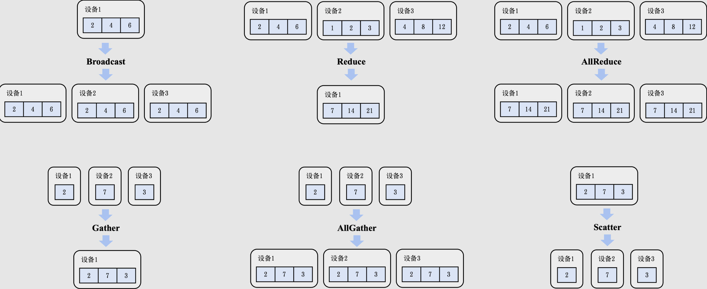
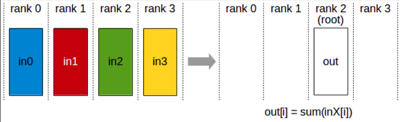
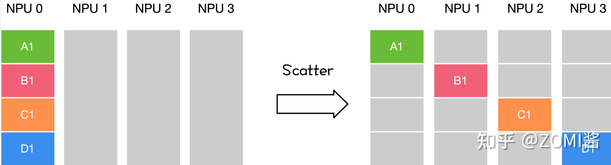
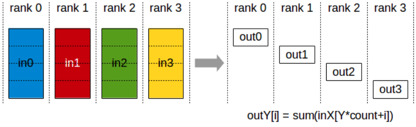
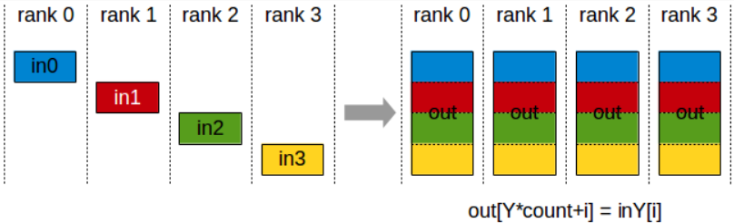
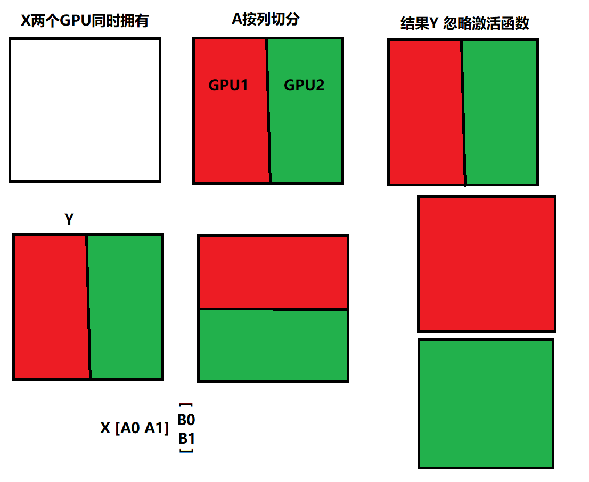
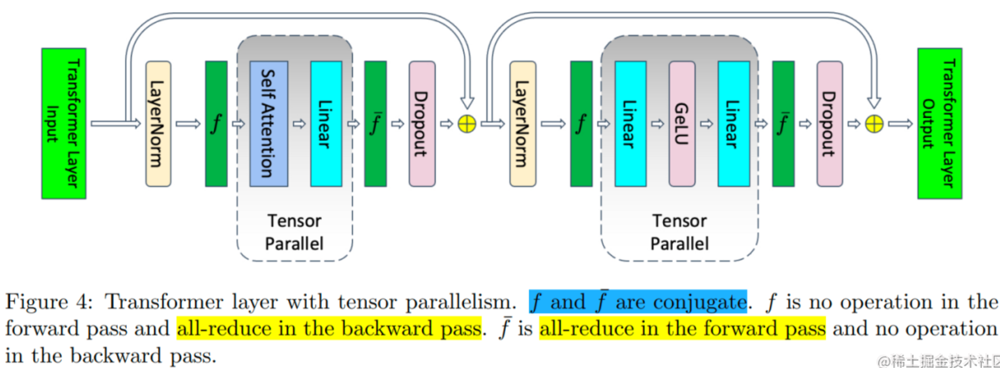
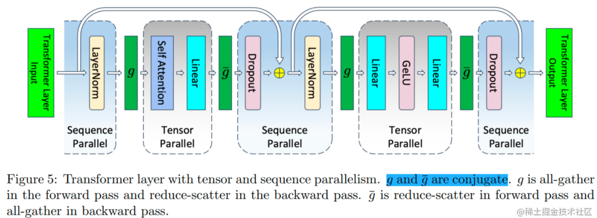
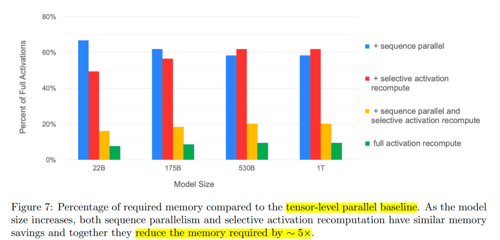
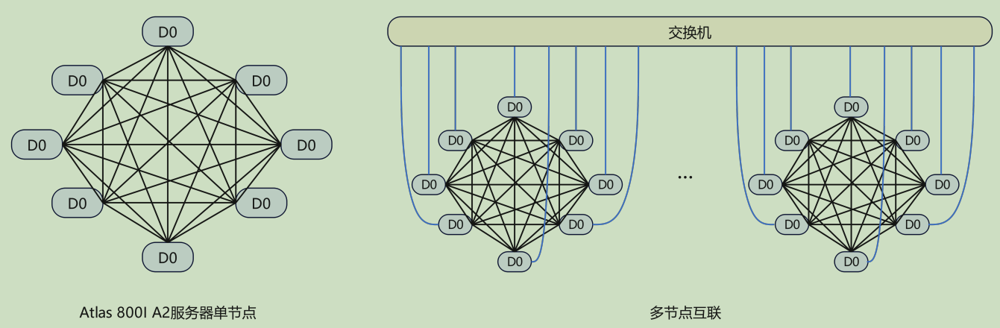

# dp tp pp zero关系

训练过程中GPU内存开销主要包含以下几个方面：

- 模型状态内存（Model State Memory）：

- - 梯度
  - 模型参数
  - **优化器状态：当使用像Adam这样的优化器时，优化器的状态会成为GPU内存开销的大头。前面介绍的DP，TP， PP算法并没有考虑这个问题。**

- **激活内存（Activation Memory）：在优化了模型状态内存之后，人们发现激活函数也会导致瓶颈。激活函数计算位于前向传播之中，用于支持后向传播。**

- 碎片内存（Fragmented Memory）：深度学习模型的低效有时是由于内存碎片所导致的。在模型之中，每个张量的生命周期不同，由于不同张量寿命的变化而会导致一些内存碎片。由于这些碎片的存在，会导致即使有足够的可用内存，也会因为缺少连续内存而使得内存分配失败。ZeRO 根据张量的不同寿命主动管理内存，防止内存碎片。

https://zhuanlan.zhihu.com/p/581677880

数据并行大小 = 总的 GPU 数目 / 流水线并行大小 / 张量并行大小

# 分布式训练中的集合通信

## 快速总览

## Reduce

对所有节点的完整数据进行求和，但是结果只存在root节点。

可以利用**环形拓扑**减少带宽竞争，规约与传输并行。

## Scatter

root节点将数据进分块，每个节点接收一块数据（例如GPU0接收第0块，GPU1接收第1块）

## Reduce-Scatter

即Reduce+Scatter。常用于ZeRO显存优化、梯度分片更新。每个节点仅存储`1/N`数据。

## All-Gather

将每个节点的部分数据汇总到**所有节点**，适用于TP、DP中的参数同步、全局统计信息聚合。

1. **数据分块**：每个节点将本地数据划分为与节点数相同的块（如4节点则分4块）。
2. **环形传递**：节点按逻辑环依次发送和接收数据块（例如节点1发送块1→节点2，同时接收节点4的块4）。
3. **多轮迭代**：经过N-1轮（N为节点数），所有节点通过拼接累积数据块完成全局同步。

**通信量与节点数无关**，适合大规模集群。总通信数据量为：
$$
(N-1)*单节点数据量，即 \frac{(N-1)}{N}*总数据量
$$

## All-Recuce

将全局数据规约后同步至所有节点，等价于 **Reduce-Scatter + All-Gather**。

主流框架（如PyTorch DDP、DeepSpeed）采用 **Ring All-Reduce**，因其通信效率与节点数无关。Ring All-Reduce中节点被组织成一个逻辑环，数据在环中按顺序传输。

1. 优点：通信效率高，适用于大规模集群。每个节点只与其邻居节点通信，减少了通信开销。
2. 在节点数量较多时，通信轮数较多，可能导致延迟增加。

3. 

理论推导：https://zhuanlan.zhihu.com/p/504957661 https://zhuanlan.zhihu.com/p/17201336684

参考**

https://docs.nvidia.com/deeplearning/nccl/user-guide/docs/usage/collectives.html

https://openmlsys.github.io/chapter_distributed_training/collective.html

https://zhuanlan.zhihu.com/p/465967735

# 张量并行

Megatron-LM中张量并行如下图。正向和反向传播各有两个All-Reduce操作，分别对应自注意力输出投影和FFN降维层的行并行计算。每个行并行线性层在前向传播时汇总分块输出（All-Reduce），反向传播时同步输入梯度（All-Reduce），从而在整体上形成两次All-Reduce的通信模式。

# 序列并行

对于长序列，激活值会占用许多显存，序列并行可以减少这些激活值所占的显存。

Megatron-LM的序列并行是在张量并行的基础上，将Transformer层中的LayerNorm和Dropout的输入按输入长度（Sequence Length）维度进行了切分，使得各个设备上面只需要做一部分的Dropout和LayerNorm即可。好处：

1. LayerNorm 和 Dropout 的计算被平摊到了各个设备上，减少了计算资源的浪费；
2. LayerNorm 和 Dropout 所产生的激活值也被平摊到了各个设备上，进一步降低了显存开销。

Megatron-LM中的序列并行+张量并行如下图所示。两者结合以后，通信方式有所改变。当有数据输入时，

1. 首先计算注意力层，即张量并行层。此时需要Reduce-Scatter求和、分发结果，得到可以传入序列并行层的格式，即每个节点只有一块求和后的数据。图中为g¯
2. 经过序列并行层Dropout和LayerNorm，此时需要All-Gather来汇聚结果，每个节点都将会拥有完整的数据块。图中为g

在Megatron-LM同时开启序列并行和模型并行时，一个Transformer层完成一次前向传播或反向传播一共有2个All-Gather和2个Reduce-Scatter算子。因此，**通过添加序列并行并没有增加额外的通信开销**，反而在后向传播代码的实现上，还把Reduce-Scatter和权重梯度的计算做了重叠，进一步减少了通信所占用的时间，使得提高设备的FLOPs Utilization成为了可能。

通过对Transformer层中所有Activation的消耗进行计算，发现在Transformer层里有一些操作是产生的激活值大，但计算量小。因此，就考虑干掉这一部分的激活值，通过选择性的进行激活重新计算（Selective Activation Recomputation）来进一步降低显存。与此同时，其他的激活值就通通保存，以节省重计算量。

通过对激活值的占比分析，序列并行降低了4成左右的激活值开销。选择性激活重新计算（selective activation recompute）也降低了4成左右的激活值开销。当两个特性都打开的时候，总共可以降低8成左右的激活值开销，尽管比全部激活值重计算的结果要稍高，但是在吞吐率上的提升还是非常的明显的

参考：https://zhuanlan.zhihu.com/p/659792351

# 流水线并行

# Deepspeed

## ZeRO1/2/3

-  [分布式训练：了解Deepspeed中的ZeRO1/2/3](https://zerolovesea.github.io/2024/05/12/%E5%88%86%E5%B8%83%E5%BC%8F%E8%AE%AD%E7%BB%83%EF%BC%9A%E4%BA%86%E8%A7%A3Deepspeed%E4%B8%AD%E7%9A%84ZeRO1-2-3/)。ZeRO切分模型等之后如何进行forward和backward

- [DeepSpeed之ZeRO系列：将显存优化进行到底](https://basicv8vc.github.io/posts/zero/)。 模型显存占用公式分析和分布式通信
- [详解 DeepSpeed Zero 的各个 Stage 状态及日常使用](https://ckblogs.cn/posts/dl/DeepSpeed.html#%E5%BC%95%E8%A8%80)。显存分析和代码

# 权重并行

权重并行可以理解为ZERO3中对模型参数的分片。它和张量并行的区别在于：

1. 张量并行每个GPU持有一部分权重，MLP层或Attention层计算之后，通过All-Reduce汇总输出。即先计算再汇总
2. 权重并行每个GPU同样持有一部分权重，先通过All-Gather汇总，然后正常做计算。即先汇总权重再计算。

# 集合通信在分布式训练中的应用

## 数据并行

# 组网

## demo1

华为Atlas 800I A2推理服务器，单节点包含8个NPU芯片，形成多机组网架构。

- 节点内拓扑。节点内通过Fullmesh形成全互联结构。
- 节点间拓扑。节点间通过网络交换机互联，形成Start结构。

## demo2

https://openmlsys.github.io/chapter_distributed_training/cluster.html

